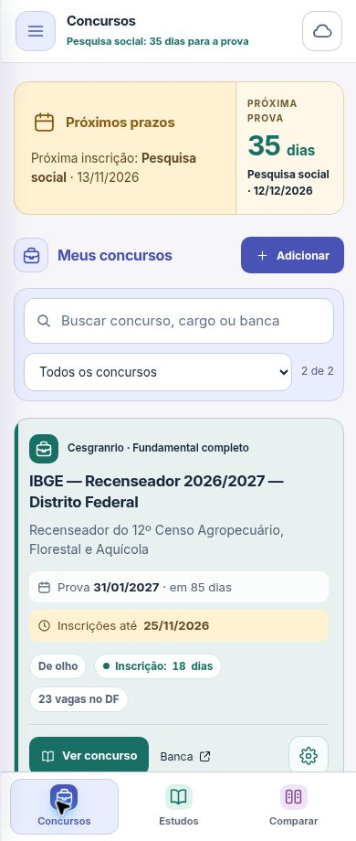

# Revisão visual 0.33.0 — 07/11/2026

Referências de código e estilo: Silhuetta 2.9.23 e Retomar 0.12.0. Foram reaproveitados os princípios de ícones lineares, bases arredondadas, áreas claras coloridas e controles proporcionais. Os IDs e o símbolo do Concursos foram preservados.

## Conferência após a implementação

- Telas em quadros de 320, 390, 760 e 1024 px; largura útil de 305, 375, 745 e 1009 px devido à barra de rolagem do navegador de teste.
- Lista preenchida com ficha IBGE e concurso de teste com título e cargo longos. Resumo, busca, cartões e datas ficaram em grupos visuais próprios.
- Navegação inferior, ícones e rótulos conferidos; ajuste adicional deixou “Meus concursos” em uma linha no menor quadro.
- Estudos: painel verde, ferramentas coloridas e revisão pendente visível. Comparação: cabeçalho e navegação em ameixa, mantendo a cor de cada concurso nos conteúdos.
- Gerenciamento e editor conferidos em 320 px, incluindo ficha expandida, cabeçalhos por seção, campos e rodapé. Sem transbordamento horizontal das caixas inspecionadas.
- Personalização: a prévia Rosa mudou Concursos, mantendo Estudos verde e Comparar ameixa; cancelar restaurou a cor anterior.
- Documento sem transbordamento horizontal nas larguras inspecionadas. Cabeçalho desktop permaneceu em uma linha, com 73 px.

`npm run verify` aprovado, com 65 testes, incluindo contraste, integridade dos símbolos SVG, nomes acessíveis da nuvem, cache da nova camada visual e regressões existentes. A medição de contraste valida as combinações principais, não constitui auditoria completa de acessibilidade.

Dados de teste isolados, sem credenciais nem sincronização real com Gist. A revisão foi em navegador; não houve validação em aparelho Android físico nesta atualização.

## Registro visual

Tela móvel com dados de teste isolados (ficha IBGE e concurso fictício).

